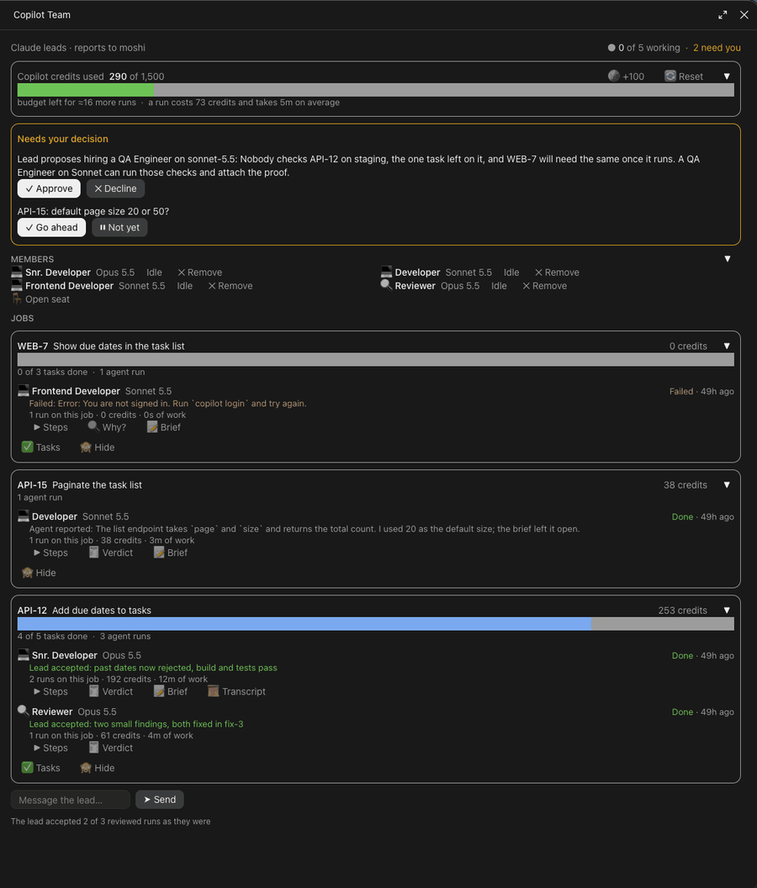

# copilot-workers

A Copilot Team pane for Claude Code. Claude acts as the lead of a small team of [GitHub Copilot CLI](https://github.com/github/copilot-cli) agents: it writes each agent a brief, runs it in the background, reviews what comes back and reports to you. The pane shows that team as it works, so you can see who's busy, what each agent is doing right now, what it cost, and step in without reading log files.



*The pane on the bundled [demo](demo/) runs, with one more WEB-7 run played into it.*

What you get in the pane:

- **Header:** who you are to the lead, how many agents are working against your seat limit, and how many decisions are waiting on you.
- **Credits:** spend against your budget with a meter, roughly how many more agent runs the rest buys, what a run costs on average, and buttons for more budget and a new budget period.
- **Needs your decision:** requests from the lead (a hire, more seats or credits) and questions it's waiting on, with Approve/Decline or Go ahead/Not yet.
- **Members:** everyone on the roster with their model and whether they're working, plus open seats. ➕ Hire next to the heading asks the lead to propose a new member; it's hidden while a request waits on you. An idle member can be removed (✕ Remove, then ✓ Remove to confirm); their past runs stay on their jobs.
- **Jobs:** one card per ticket or task, with task progress counted from the job's checklist (any markdown file with `- [ ]` / `- [x]` items, such as an OpenSpec `tasks.md`; jobs without one simply show no bar), and per member the current step and command, the lead's verdict on its last run, and its runs, credits and time on the job. **▸ Steps** opens what the lead asked and the agent's last steps; **📝 Brief**, **📜 Transcript** and **✅ Tasks** open the files, and ⏹ Stop, 🧾 Verdict, 🔍 Why? and 🔁 Restart ask the lead about a member's run. Each finished run carries the lead's verdict (accepted or sent back) or, before review, the agent's own summary.
- **Message the lead:** a box that sends your message straight into the Claude session.

Buttons that need the lead send a message to the Claude session (prefixed `[Copilot Team · <you>]`); Decline and Remove only change `team.json`, which the lead reads before it acts, so they cost no Claude turn. The agents never take orders from the pane directly. On the phone over Remote Control, `/copilot-workers` prints a text snapshot instead.

## Requirements

Claude Code 2.1.309 or later. Older versions refuse the pane's text sizes and weights and draw nothing. The pane is tested on the terminal and desktop surfaces; on the phone over Remote Control, `/copilot-workers` prints a text snapshot.

The pane only shows what the lead writes (see below), so it's empty until you have the [GitHub Copilot CLI](https://github.com/github/copilot-cli) installed and tell Claude to run agents this way.

## Install

At the prompt of a terminal session:

```
/plugin install copilot-workers --marketplace mmrs/claude-plugins
```

Or from a shell:

```bash
claude plugin install copilot-workers --marketplace mmrs/claude-plugins
```

Answer `y` to add the marketplace and pick the user scope. The install then asks for the plugin's options: your name (`ownerName`), which the pane shows as who the lead reports to, `runsDir` if your runs don't live in `~/.claude/copilot-runs`, `creditBudget`, the credit budget each period starts with and 🔄 Reset goes back to (empty keeps the current one), `creditStep`, how many credits the 🪙 button adds to the budget (500 unless you change it), and `warnAtPercent`, how much of the budget is spent before the meter turns to a warning (85 unless you change it). Open the pane with `/copilot-workers`.

In the desktop app, where `/plugin` doesn't run: click **+** next to the prompt box, then **Plugins**, **Add marketplace** with `mmrs/claude-plugins`, then **Add plugin**.

## Try it without Copilot

`demo/runs/` is a made-up runs folder: a team of four, three jobs, a run the lead sent back, a failed one and a question waiting for you. Copy it out (the pane's buttons write to it), point `runsDir` at the copy, and open `/copilot-workers`. [demo/README.md](demo/README.md) has the steps.

## How Claude feeds it

The plugin ships a skill, `copilot-workers:lead-copilot`, that teaches Claude to lead the team: when to hand work to an agent and when to do it itself, how to brief and start a run, how to review it and record a verdict, and what each button in the pane asks for. Claude loads it when you ask for the team or press a button in the pane, so there's nothing to set up beyond the install. Your own instructions still win: "use the team" or "do it yourself" on any request overrides its rule.

The pane only reads files, so it also works with any other lead that writes them. The layout:

- **Run logs:** each Copilot run writes its output to `<runsDir>/copilot-<name>.log`. The first line is a header the pane parses:

  ```
  # role=fix model=claude-sonnet-5.5 repo=my-repo job=TICKET-1 member=mid-dev
  ```

  Pass `--share <runsDir>/copilot-<name>.md` to get a transcript, and save the brief as `<runsDir>/copilot-<name>.brief.md`. When Copilot returns, append its exit code to the log:

  ```bash
  copilot -p "$(cat brief.md)" … >> "$LOG" 2>&1; echo "# exit=$?" >> "$LOG"
  ```

  A non-zero code marks the run **Failed** right away, with Copilot's last line as the reason (`command not found: copilot`, a sign-in or quota error). Without that line the pane can't tell a failed start from a slow one: a run counts as done when Copilot prints its `AI Credits` summary, and as stopped after ten minutes without output.

- **`team.json`** is yours: `seats`, `creditBudget`, `budgetSince` and a `roster` of `{ member, model, title?, group?, icon? }`. Without an `icon`, the pane picks one from the member's name and title: 💻 developers, 🔍 reviewers, 🧪 QA or testers, 🤖 anyone else. The lead may add a `request` (`{ seats?, credits?, hire?, reason }`) for you to approve in the pane.

- **`lead.json`** is the lead's: `jobs` (`{ "<id>": { title, tasks?, hidden? } }`, where the optional `tasks` is the path to any markdown checklist), `verdicts` on finished rounds (`{ "<log name>": { accepted, note } }`) and `waiting`, the questions it needs you to answer (`[{ id, text }]`).

## Development

From the repository root, run `claude plugin test plugins/copilot-workers`. The tests mount the pane on the terminal and desktop surfaces against a fake runs folder: the header, numbered titles, checklist counts, verdicts and credits, a failed run, removing a member, the order of runs copied in one go, and folds kept across a restart.

## Licence

MIT
